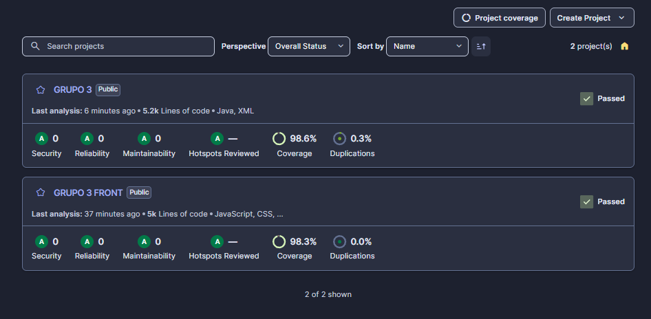

# Cómo logramos estos resultados en SonarQube

**Proyecto:** Sazloop · Grupo 3
**Para:** Emanuel y todo el equipo
**Fecha:** 27 de noviembre de 2026

> **En pocas palabras:** el profesor nos bajó puntos porque el análisis de calidad mostraba problemas y **0 % de pruebas**. En dos días corregimos todos los problemas y agregamos **547 pruebas automáticas**. Ahora el backend y el frontend salen **en verde y con todo en A**. Los resultados se pueden **comprobar**: cualquiera del grupo puede repetirlos en su PC y le deben salir iguales.

---

## 1. El resultado



| | Backend («GRUPO 3») | Frontend («GRUPO 3 FRONT») |
|---|---|---|
| Seguridad | 🟢 **A** · 0 problemas | 🟢 **A** · 0 problemas |
| Fiabilidad | 🟢 **A** · 0 problemas | 🟢 **A** · 0 problemas |
| Mantenibilidad | 🟢 **A** · 0 problemas | 🟢 **A** · 0 problemas |
| Cobertura de pruebas | 🟢 **98,6 %** | 🟢 **98,3 %** |
| Código repetido | 0,3 % | 0,0 % |
| Veredicto final | ✅ **Passed** | ✅ **Passed** |

---

## 2. ¿Qué significa cada cosa? (sin tecnicismos)

**SonarQube** es un programa que **revisa el código como un corrector**. No ve la app como un usuario: lee el código y marca lo que está mal escrito o es riesgoso.

| En la tarjeta dice… | Quiere decir… | Nosotros |
|---|---|---|
| **Security** (Seguridad) | ¿Hay algo que un atacante pueda aprovechar? | A, ninguno |
| **Reliability** (Fiabilidad) | ¿Hay código que puede fallar y romper algo? | A, ninguno |
| **Maintainability** (Mantenibilidad) | ¿El código está ordenado y es fácil de entender y cambiar? | A, ninguno |
| **Hotspots Reviewed** | Partes delicadas que una persona debería revisar a mano | Ninguna encontrada (por eso sale «—») |
| **Coverage** (Cobertura) | De todo el código, **¿cuánto se prueba solo, de forma automática?** | ~98 % en los dos |
| **Duplications** | ¿Cuánto código está copiado y pegado? | Casi nada |
| **Passed** | Aprobó todas las reglas de calidad de SonarQube | ✅ Los dos |

### ¿Qué es eso de «cobertura»?

Imagina que la app es un edificio y cada línea de código es un cuarto. Una **prueba automática** es un inspector que entra a ciertos cuartos y comprueba que todo funcione.

- **0 % de cobertura** = ningún inspector entraba a ningún cuarto.
- **98 % de cobertura** = los inspectores revisan 98 de cada 100 cuartos, **solos**, cada vez que alguien cambia algo.

Ojo: la cobertura **no dice que la app sea perfecta**. Dice que casi todo el código **se prueba automáticamente**, así que si alguien rompe algo, una prueba avisa.

---

## 3. Antes y después

| | Lo que vio el profesor (20 de octubre) | Ahora (27 de noviembre) |
|---|---|---|
| **Backend**: problemas encontrados | 105 | **0** |
| **Backend**: cobertura | 🔴 0 % | 🟢 **98,6 %** |
| **Backend**: pruebas automáticas | 16 (SonarQube no las veía) | **239** |
| **Frontend**: problemas encontrados | 68 | **0** |
| **Frontend**: cobertura | 🔴 0 % | 🟢 **98,3 %** |
| **Frontend**: pruebas automáticas | 0 | **308** |

---

## 4. Qué hicimos, paso a paso

### Paso 1 · Instalar SonarQube en nuestra PC
Lo instalamos dentro de **Docker** (un programa que deja correr otras aplicaciones aisladas). Así cualquiera del grupo tiene el mismo SonarQube que usamos nosotros.

### Paso 2 · Corrección de Emanuel (auditoría)
Emanuel corrigió la mayoría de los problemas del primer análisis (commit `019122a`). El backend bajó de **105 a 2 problemas**.

### Paso 3 · Descubrir por qué la cobertura salía en 0 %
El backend **sí tenía pruebas**, pero SonarQube no podía verlas. Faltaba **JaCoCo**, una herramienta que «cuenta» qué partes del código recorren las pruebas. La agregamos y el backend pasó de **0 % a 77 %** sin escribir una sola prueba nueva.

### Paso 4 · Corregir los problemas que quedaban
- **Backend:** 2 problemas. Una búsqueda de texto que podía volverse lenta y una prueba que comparaba horas sin zona horaria.
- **Frontend:** 51 avisos del mismo tipo. Eran llamadas al servidor que no decían qué hacer si fallaban. Ahora, por ejemplo, si el carrito no puede cargar, la app **muestra un mensaje** en vez de quedarse en blanco.

### Paso 5 · Escribir las pruebas del frontend (308)
El frontend no tenía **ninguna** prueba. Creamos un **navegador simulado**: un programa que abre las páginas reales de la app sin mostrarlas en pantalla, hace clics, llena formularios como una persona y revisa lo que aparece.

Se probaron **todas las pantallas**:
- inicio de sesión y registro de los 3 tipos de usuario;
- catálogo, filtros y «Cerca de mí»;
- carrito, pago con Yape y tarjeta, delivery y cancelaciones;
- compra con QR en el local;
- reseñas, perfil y notificaciones;
- portales de empresa, trabajador y administrador.

### Paso 6 · Pruebas de los casos de error del backend (207 más)
Al backend le faltaba probar **qué pasa cuando algo sale mal**. Por ejemplo:
- comprar sin stock, o con un código de recojo ya usado;
- entregar un pedido que es de otro local;
- subir un documento vencido, muy pesado o de un tipo no permitido;
- equivocarse 5 veces de contraseña (bloqueo de 5 minutos);
- que un dueño intente ver los datos de otro dueño.

Se agregaron 207 pruebas de estos casos. El backend llegó a **98,6 %**.

### Paso 7 · Probar la app de verdad, en el navegador
Además de las pruebas automáticas, usamos la app como usuarios reales:
- entramos a los 4 portales (consumidor, empresa, trabajador y administrador);
- un consumidor compró un pack;
- el trabajador validó el código y entregó el pedido.

Todo funcionó.

---

## 5. ¿Los resultados son reales? Sí, y así se puede comprobar

No hay que «creernos». Todo se puede revisar:

### ✅ Las pruebas se pueden ver
Están en el repositorio de GitHub:
- **Backend:** carpeta `backend/src/test/`, 36 archivos de pruebas.
- **Frontend:** carpeta `frontend/tests/`, 28 archivos de pruebas.

Cada prueba tiene un nombre que dice qué revisa, en español. Por ejemplo: *«si el código ya fue usado, no deja entregar de nuevo»*.

### ✅ Las pruebas comprueban cosas de verdad
No son pruebas vacías. Entre todas hacen **más de 2.000 comprobaciones**, por ejemplo:
- que aparezca el texto correcto en pantalla;
- que se envíen al servidor los datos correctos;
- que salga el mensaje de error correcto;
- que el stock baje al comprar y vuelva a subir al cancelar.

### ✅ No hicimos trampa con el código de la app
Para que las pruebas pasen **no se cambió cómo funciona la app**. En todo este trabajo, la app solo cambió en **14 archivos y unas 56 líneas**, y todas son las correcciones del paso 4. Las 547 pruebas se agregaron **aparte**, en sus propias carpetas. En GitHub se puede ver exactamente qué cambió en cada commit.

### ✅ Cualquiera del grupo lo puede repetir
Si alguien corre las pruebas y el análisis en su propia PC, le deben salir **los mismos números**. Los pasos están en la sección 8.

### ✅ Lo que NO significa
Para ser honestos: tener 98 % de cobertura **no garantiza cero errores**. Significa que casi todo el código se prueba automáticamente, lo que hace muy difícil que un error pase sin que alguien se entere. Además:
- el análisis se hizo con **nuestro** SonarQube (versión 26.11), no con el del profesor. Si él usa otra versión, algún número podría variar un poco;
- el «antes» del profesor y nuestro «ahora» no son 100 % comparables regla por regla, porque las versiones de SonarQube cambian sus reglas.

---

## 6. Preguntas que podría hacer el profesor

**«¿Por qué antes salía 0 % si tenían pruebas?»**
Porque faltaba JaCoCo, la herramienta que mide la cobertura. Sin ella, SonarQube no puede contar qué se prueba.

**«¿Cómo prueban el frontend sin abrir el navegador?»**
Con un navegador simulado (se llama **jsdom**). Abre las páginas HTML reales y ejecuta el JavaScript real, igual que Chrome, pero sin pantalla.

**«¿Qué prueban exactamente en el backend?»**
Las reglas del negocio: compras, stock, códigos de recojo, cancelaciones con 50 % de reembolso, aprobación de locales, documentos, sesiones y bloqueo por intentos fallidos. Sobre todo **los casos de error**.

**«¿Encontraron errores al probar?»**
No encontramos errores en la app. Sí aparecieron **3 reglas de negocio** que el grupo tiene que confirmar (sección 7).

**«¿Cuánto tardan en correr las pruebas?»**
Alrededor de 1 minuto el backend (incluye armar el proyecto) y menos de 10 segundos el frontend.

---

## 7. Para decidir como equipo

Al probar salieron 3 comportamientos que **no son errores**, pero hay que confirmar si así los queremos:

1. Un pedido **pagado que nadie recogió** cuenta en el resumen de la empresa como **venta** y también como **«no recogido»**.
2. Un pedido **pagado y después cancelado** sigue sumando la **comisión de Sazloop**.
3. Si el administrador rechaza con un motivo que es solo puntuación («. .»), el aviso sale como *«Motivo: . Puedes adjuntar…»*.

---

## 8. Cómo repetir todo (para quien quiera comprobarlo)

Necesitas **Docker Desktop**, **Java 21** y **Node 22 o superior**.

**1. Encender SonarQube**
- Abre Docker Desktop.
- La primera vez, en una terminal: `docker run -d --name sonarqube -p 9000:9000 sonarqube:community`
- Entra a http://localhost:9000 (usuario `admin`, contraseña `admin` la primera vez) y crea un token en *My Account → Security*.

**2. Backend:** desde la carpeta `backend`

```bat
set SPRING_PROFILES_ACTIVE=dev
mvnw.cmd clean verify sonar:sonar -Dsonar.token=TU_TOKEN
```

**3. Frontend:** desde la carpeta `frontend`

```bat
npm install
npm run test:cobertura
docker run --rm -e SONAR_TOKEN=TU_TOKEN -e SONAR_HOST_URL=http://host.docker.internal:9000 -v "%cd%:/usr/src" sonarsource/sonar-scanner-cli
```

**4. Mirar el resultado** en http://localhost:9000/projects. Deben salir las dos tarjetas en verde.

---

## 9. Dónde está cada cosa

| Qué | Dónde |
|---|---|
| Este documento | `docs/informes/Proyecto final/auditoria/COMO_LOGRAMOS_ESTOS_RESULTADOS.md` |
| La captura de SonarQube | `docs/informes/Proyecto final/auditoria/capturas/sonarqube-proyectos.png` |
| Informe técnico completo | `docs/informes/Proyecto final/auditoria/INFORME_CALIDAD_Y_PRUEBAS_2026-11-26.md` |
| Resumen corto | `docs/informes/Proyecto final/auditoria/RESUMEN_PARA_EL_LIDER.md` |
| Pruebas del backend | `backend/src/test/` |
| Pruebas del frontend | `frontend/tests/` |
