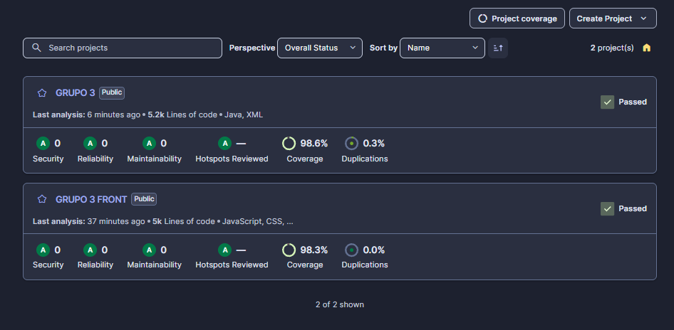

# Informe de calidad y pruebas: frontend y backend

**Proyecto:** Sazloop (Grupo 3)
**Fecha:** 26 de noviembre de 2026 (actualizado el 27 de noviembre de 2026 con las pruebas de pantallas del frontend)
**Herramientas:** SonarQube Community Build 26.11 (local, en Docker), JaCoCo 0.8.13 (cobertura del backend), JUnit 5 + Mockito + Spring Boot Test (pruebas del backend), ejecutor de pruebas de Node 24 + jsdom 26 (pruebas y cobertura del frontend con un navegador simulado), navegador real (pruebas de funcionamiento).

Este informe responde a las observaciones del profesor sobre el código: **levantar las observaciones encontradas**, **completar las pruebas unitarias** y **aplicar herramientas de análisis de calidad y pruebas al proyecto**.

---

## 1. Resultado final

| | Backend («GRUPO 3») | Frontend («GRUPO 3 FRONT») |
|---|---|---|
| Seguridad | **A** (0) | **A** (0) |
| Fiabilidad | **A** (0) | **A** (0) |
| Mantenibilidad | **A** (0) | **A** (0) |
| Hotspots de seguridad | 0 | 0 |
| **Cobertura** | **98,6 %** | **98,3 %** |
| Duplicados | 0,3 % | 0,0 % |
| Pruebas automáticas | **239** (todas pasan) | **308** (todas pasan) |
| Líneas de código | 5.190 | 5.019 |
| Umbral de calidad | **Pasa** ✅ | **Pasa** ✅ |

**En resumen:** los dos proyectos tienen **cero observaciones**, **A en todas las calificaciones** y **pasan el umbral de calidad**. La cobertura, que estaba en **0 %** en los dos, ahora es **98,6 %** en el backend (99 % de líneas) y **98,3 %** en el frontend (100 % de líneas). En total son **547 pruebas automáticas**.

### Capturas de SonarQube



---

## 2. Antes y después

«Antes» es el análisis que envió el profesor (informes `g3-full-issues-breakdown` y `g3front-full-issues-breakdown`, del 20 de octubre de 2026). «Después» es el análisis de esta rama.

| Indicador | Backend antes | Backend después | Frontend antes | Frontend después |
|---|---|---|---|---|
| Seguridad | A (0) | A (0) | B (8) | **A (0)** |
| Fiabilidad | C (46) | **A (0)** | C (2) | **A (0)** |
| Mantenibilidad | A (59) | **A (0)** | A (58) | **A (0)** |
| Cobertura | 0,0 % | **98,6 %** | 0,0 % | **98,3 %** |
| Duplicados | 0,4 % | 0,3 % | 0,0 % | 0,0 % |
| Umbral de calidad | — | **Pasa** | — | **Pasa** |

**Cómo se llegó aquí, paso a paso:**

| Paso | Backend | Frontend |
|---|---|---|
| Análisis del profesor (20/10) | 105 observaciones, 0 % | 68 observaciones, 0 % |
| Corrección de la auditoría (commit `019122a`) y primer análisis de esta rama | 2 observaciones, 75,7 % (16 pruebas) | 51 observaciones, 0 % |
| Correcciones y pruebas unitarias (26/11) | **0 observaciones, 77,1 % (32 pruebas)** | 0 observaciones, 14,5 % (20 pruebas) |
| Pruebas de pantallas del frontend (27/11) | — | **0 observaciones, 98,3 % (308 pruebas)** |
| Casos de error del backend (27/11) | **0 observaciones, 98,6 % (239 pruebas)** | — |

**Aviso:** el análisis del profesor se hizo con otro servidor y otra versión de SonarQube. Algunas reglas cambian entre versiones, así que los números de «antes» no son 100 % comparables uno a uno con los de «después».

---

## 3. Backend

### 3.1 Por qué la cobertura estaba en 0 %

El proyecto **ya tenía pruebas**, pero SonarQube no podía medirlas porque faltaba **JaCoCo**, la herramienta que registra qué líneas recorren las pruebas. Se agregó en `backend/pom.xml`, junto con la configuración de SonarQube (`sonar.projectKey`, `sonar.host.url` y la ruta del informe de JaCoCo).

### 3.2 Observaciones corregidas (2)

| # | Regla | Archivo | Problema | Corrección |
|---|---|---|---|---|
| 1 | `java:S8786` | `afiliacion/service/RevisionAfiliacionService.java` | La expresión regular `[.\s]+$` de `sinPuntuacionFinal()` podía ser lenta con textos especiales (*backtracking*). | Se reemplazó por un bucle que recorre el texto desde el final y quita puntos y espacios. Mismo resultado, sin riesgo de lentitud. |
| 2 | `java:S8700` | `src/test/.../TiempoYRegistrosTests.java` | Calculaba una duración entre dos `LocalDateTime`, que no tienen zona horaria. | Ahora compara dos `ZonedDateTime` en la zona `America/Lima`. |

### 3.3 Pruebas unitarias nuevas (16)

| Archivo nuevo | Pruebas | Qué revisa |
|---|---|---|
| `shared/LimiteIntentosLoginTests` | 7 | Bloqueo tras N fallos (429), mensaje en singular y plural, mayúsculas y espacios del correo, reinicio del contador tras un ingreso correcto, contador separado por tipo de acceso, valores de configuración inválidos |
| `experiencia/service/ImpactoServiceTests` | 4 | Fórmula de impacto ambiental (RF-26): 2 packs medianos = 2 kg y 5 kg de CO₂; suma de varios tamaños (4,5 kg y 11,25 kg); tamaño desconocido = 1 kg; reserva vacía = 0 |
| `ofertas/service/DistanciaHaversineTests` | 5 | «Cerca de mí»: el mismo punto está a 0 km, Miraflores–San Borja ≈ 4 km, redondeo a 2 decimales, sin ubicación del consumidor o del local no hay distancia |

### 3.4 Todas las pruebas del backend (32)

Comando: `mvnw.cmd clean verify` con el perfil `dev` (H2). **Resultado: 32 pruebas, 0 fallos, 0 errores.**

| Archivo de pruebas | Pruebas | Qué revisa |
|---|---|---|
| `SazloopApplicationTests` | 1 | Que la aplicación arranque |
| `DatosDemoH2Tests` | 1 | Que los datos de demostración se carguen bien |
| `FlujoAfp2Tests` | 3 | Flujo de afiliación de locales |
| `PortalEmpresaEtapasTests` | 1 | Etapas del portal de empresa |
| `ResolucionYSesionesTests` | 3 | Resolución de solicitudes e inicios de sesión |
| `TiempoYRegistrosTests` | 2 | Hora de Lima y registros |
| `VigenciaYAvisosTests` | 4 | Vencimiento de documentos y avisos |
| `afiliacion/SolicitudAfiliacionServiceTests` | 1 | Servicio de solicitudes de afiliación |
| `shared/LimiteIntentosLoginTests` *(nuevo)* | 7 | Límite de intentos de inicio de sesión |
| `experiencia/service/ImpactoServiceTests` *(nuevo)* | 4 | Impacto ambiental |
| `ofertas/service/DistanciaHaversineTests` *(nuevo)* | 5 | Distancia «Cerca de mí» |

### 3.5 Cobertura (JaCoCo)

| Medida | Antes de las pruebas nuevas | Después |
|---|---|---|
| Líneas | 83,5 % | **84,4 %** |
| Ramas (`if`, `switch`, etc.) | 58,9 % | **61,4 %** |
| Total que muestra SonarQube | 75,7 % | **77,1 %** |

El informe detallado se genera en `backend/target/site/jacoco/index.html` al correr las pruebas.

### 3.6 Casos de error del backend (207 pruebas más, 27/11)

Con 32 pruebas el backend quedaba en 77,1 %: casi todo lo que faltaba eran **los caminos de error** (datos inválidos, sin stock, códigos repetidos, permisos de otro dueño, documentos vencidos, etc.). Se agregaron **207 pruebas** que recorren esos casos, en cuatro áreas. **No se modificó ningún archivo de la app.**

| Área | Archivos de pruebas | Pruebas | Qué revisa |
|---|---|---|---|
| Afiliación | `afiliacion/RevisionAfiliacionServiceTests`, `SolicitudAfiliacionReglasTests`, `VigenciaDocumentosServiceTests`, `service/AlmacenDocumentoServiceTests`, `service/AdministradorServiceTests`, `controller/AfiliacionControllersTests` | 52 | Aprobar y rechazar solicitudes y documentos, motivos, renovaciones, suspensiones automáticas y manuales, avisos, archivos PDF/PNG/JPG (tipo real, tamaño, rutas inválidas), sesión del administrador y respuestas HTTP 400/401/404/409 |
| Ofertas y experiencia | `ofertas/service/OfertaServiceTests`, `PanelLocalServiceTests`, `controller/OfertasControllerTests`, `repository/CalificacionTests`, `experiencia/service/ResenaServiceTests`, `NotificacionServiceTests`, `controller/ExperienciaControllerTests` | 45 | Búsqueda con todos sus filtros y «Cerca de mí», ofertas vencidas u ocultas, reglas de publicación de packs, panel del local, reseñas (solo después del recojo, una por compra) y notificaciones |
| Compras y reservas | `reservas/CompraRecojoServiceTests`, `CompraPresencialServiceTests`, `CancelacionYVencimientoTests`, `service/AvisosReservaServiceTests`, `ReservasControllerTests` | 44 | Compras simples y en lote, stock, variantes ajenas, delivery, consumidor bloqueado, código de recojo (minúsculas, sin guion, de otro local, repetido), compra con QR, reserva en efectivo y su vencimiento, cancelación con 50 % de reembolso |
| Identidad y sesiones | `identidad/IdentidadServiciosTests`, `IdentidadControladoresTests`, `service/CodificadorContrasenaTests`, `service/IndicadoresEmpresaServiceTests`, `afiliacion/service/AdministradorAccesoTests`, `shared/SesionesPorRolTests`, `LimiteIntentosLoginCaducidadTests` | 66 | Perfil y foto, cambio de contraseña, contraseñas cifradas (PBKDF2), registro, empresas y RUC, cuentas de trabajador, sesiones de cada rol, bloqueo por intentos y su vencimiento, indicadores de la empresa |

**Resultado:** **239 pruebas del backend, 0 fallos.**

| Cobertura del backend | Antes (32 pruebas) | Ahora (239 pruebas) |
|---|---|---|
| Líneas | 84,4 % | **99,0 %** |
| Ramas | 61,4 % | **97,8 %** |
| Total que muestra SonarQube | 77,1 % | **98,6 %** |

Lo poco que queda sin cubrir son casos que solo pasan si dos personas hacen lo mismo al mismo tiempo, o errores de Java que no se pueden provocar (por ejemplo, que el algoritmo de cifrado no exista).

**Observaciones de negocio para revisar con el grupo** (no son errores, pero conviene confirmar que es lo que se quiere):
- En el resumen de la empresa, un pedido **pagado que no se recogió** (vencido) cuenta a la vez como **venta** y como **«no recogido»**.
- Un pedido **pagado y después cancelado** sigue sumando la **comisión de Sazloop**.
- Si el motivo de un rechazo es solo puntuación (por ejemplo «. .»), el aviso dice «Motivo: . Puedes adjuntar…».

---

## 4. Frontend

### 4.1 Observaciones corregidas (51, de la misma regla)

**Regla `javascript:S9383`:** *«Las promesas deben esperarse con `await`, terminar en `.catch`, o marcarse como ignoradas con `void`»*.

En palabras simples: el código lanzaba funciones asíncronas (avisos en pantalla o funciones que piden datos al servidor) sin esperar su resultado y sin decir si eso era a propósito.

**Cómo se corrigió:**
- Se revisó cada una de las 51 llamadas. En 50 casos la función **ya atrapa sus propios errores** (tiene su `try/catch`) o es un aviso de SweetAlert2 que no falla. Esas se marcaron con `void`, que es la forma estándar de decir «se lanza a propósito sin esperar». El comportamiento no cambia.
- En `app/compras.js`, `mostrarCarrito()` **no atrapaba sus errores**. Se le agregó `.catch(...)`, que ahora muestra el aviso «No se pudo mostrar el carrito» si algo falla, en vez de dejar la pantalla sin mensaje.

| Archivo | Correcciones |
|---|---|
| `app/accesos.js`, `app/compras.js` | 9 cada uno |
| `app/ofertas-portal.js` | 7 |
| `app/qr.js` | 5 |
| `app/trabajador.js` | 4 |
| `app/panel.js`, `app/perfil.js`, `app/resenas-portal.js` | 3 cada uno |
| `app/comun.js`, `app/empresa.js`, `app/portal-main.js` | 2 cada uno |
| `app/notificaciones.js`, `app/portal.js` | 1 cada uno |

### 4.2 Pruebas unitarias nuevas del frontend (20)

El frontend no tenía pruebas. Se agregó `frontend/tests/comun.test.js` con **20 pruebas** de `app/comun.js`, el archivo de funciones compartidas por todas las páginas. Usan el ejecutor de pruebas que trae Node, así que **no hay que instalar nada**.

Qué revisan: formato de precios, punto final de los mensajes, texto del delivery, vigencia de la tarjeta (acepta el mes actual y rechaza el anterior), detección de falta de internet, creación de elementos sin `innerHTML`, avisos de SweetAlert2 (error, advertencia, éxito, confirmación y el caso sin SweetAlert2), y las llamadas al backend (cookie de sesión, respuesta 204, mensajes de negocio, traducción de errores técnicos a texto claro y errores 5xx).

**Resultado:** 20 pruebas, 0 fallos. `app/comun.js` queda con **100 % de líneas** cubiertas.

### 4.3 Pruebas de las pantallas (288 pruebas más)

Con solo las pruebas de `comun.js`, el umbral de SonarQube no pasaba: pide **80 % de cobertura en el código nuevo**, y las 51 líneas corregidas están dentro de las pantallas (botones, formularios), que necesitan un navegador para ejecutarse.

Por eso se agregaron pruebas de **todas las pantallas** con **jsdom**, un navegador simulado que corre dentro de Node. Cada prueba:
1. carga la página HTML **real** del proyecto (por ejemplo `compras.html`);
2. ejecuta su JavaScript **real**, sin cambiarlo;
3. responde las llamadas al backend con datos de ejemplo con la misma forma que los del backend real;
4. simula lo que haría la persona (clics, formularios, cantidades, permisos de ubicación, confirmaciones);
5. comprueba lo que se ve en pantalla, lo que se envió al servidor y los avisos que aparecieron;
6. al final, comprueba que **no hubo ningún error de JavaScript** en la página.

El simulador está en `frontend/tests/navegador.js`. **No se modificó ningún archivo de la app** para estas pruebas.

| Archivo de pruebas | Pruebas | Qué revisa |
|---|---|---|
| `accesos-consumidor`, `accesos-consumidor-registro` | 19 | Ingreso y registro del consumidor: éxito, contraseña equivocada (401), bloqueo por intentos (429), sin conexión, correo repetido, enlace de vuelta al QR |
| `accesos-locales`, `accesos-locales-registro` | 10 | Pestañas trabajador / empresa, ingreso de cada uno y registro de empresa |
| `accesos-administrador` | 5 | Ingreso del administrador y sus errores |
| `acceso-inicio` | 10 | Ventana de acceso y menú móvil de la página pública |
| `portal`, `portal-sin-sesion` | 18 | Barra del consumidor, contador del carrito, foto, cerrar sesión, cambio de vista sin recargar y redirección sin sesión |
| `inicio-consumidor`, `catalogo` | 25 | Novedades, catálogo, filtros, «Cerca de mí» con y sin permiso, detalle del pack y añadir al carrito con sus validaciones |
| `compras`, `compras-vacio` | 28 | Carrito, cantidades y stock, recojo o delivery, pago con Yape y tarjeta (vencida y vigente), términos, compra confirmada, historial en todos sus estados y cancelación con reembolso |
| `qr`, `qr-sin-sesion`, `qr-invalido`, `qr-oferta-error` | 16 | Compra en el local con QR: pago, reserva en efectivo, enlace inválido, oferta que no existe y redirección al ingreso |
| `resenas` | 8 | Pedido de reseña tras recoger, estrellas, comentario, omitir y errores |
| `perfil` | 12 | Editar datos, cambiar contraseña y foto (tipo inválido, muy grande, subida correcta) |
| `notificaciones` | 6 | Lista, marcar una o todas como leídas, vacía y con error |
| `empresa`, `empresa-registro`, `empresa-sin-sesion` | 51 | Resumen con cifras e impacto (kg y CO₂), locales en cada estado, registrar local con y sin ubicación, documentos, solicitud, cuenta del trabajador, notificaciones y errores |
| `panel` | 18 | Piezas compartidas de los paneles (insignias, tablas, fechas, cifras, avisos) |
| `trabajador`, `trabajador-sin-sesion` | 38 | Crear y publicar pack (con validaciones), pack publicado y QR, local suspendido, validar y entregar códigos (pagado, delivery, efectivo, ya usado, inexistente, sin conexión) |
| `administrador`, `administrador-sin-sesion` | 24 | Solicitudes nuevas y de renovación, revisar documentos, aprobar y rechazar (con motivo obligatorio), establecimientos y errores |

**Resultado:** **308 pruebas del frontend** (20 + 288), **0 fallos**, más de 1.200 comprobaciones.

| Cobertura del frontend | Valor |
|---|---|
| Líneas | **100 %** (los 17 archivos de la app) |
| Ramas | **94,2 %** |
| Total que muestra SonarQube | **98,3 %** |
| Cobertura del código nuevo (umbral) | **97,2 %** (pide 80 %) ✅ |

Las pruebas no encontraron errores en la app. Solo apareció un detalle menor: en `ofertas-portal.js`, línea 252, la condición `!Number.isInteger(l.cantidad)` nunca se cumple, porque la línea 245 ya rechaza esas cantidades antes. Es código sobrante, no un fallo.

---

## 5. Pruebas de funcionamiento (en el navegador)

Hechas con el perfil `dev,demo` (H2 con datos de demostración) en http://localhost:8080, **antes y después** de las correcciones.

### 5.1 Ingreso a cada portal

| Portal | Cuenta de demo | Resultado |
|---|---|---|
| Consumidor | `demo.consumidor1@sazloop.test` | ✅ Entra a «Hola, Valeria». Abren bien Inicio, Productos (3 packs), Mis compras, Notificaciones y Mi perfil. |
| Empresa | `duena.aurora@sazloop.test` | ✅ Portal de empresa «Aurora Cocina»: resumen, comisión, cancelaciones, packs entregados, **comida recuperada (kg)** y **CO₂ evitado**. Muestra «1 local espera aprobación». |
| Trabajador | `demo.miraflores` | ✅ Portal del local «Aurora Miraflores» con el pack publicado, horario, dieta y stock. |
| Administrador | `demo.admin@sazloop.test` | ✅ «Revisión de locales» con la solicitud pendiente de Aurora San Borja. |

En ninguna pantalla apareció «null», «undefined» ni «NaN», y la consola del navegador no mostró errores.

### 5.2 Flujo principal: compra y entrega

| Paso | Resultado esperado | Resultado |
|---|---|---|
| Consumidor (Diego) compra 1 pack mediano de Aurora Miraflores con Yape | Compra creada (201), estado CONFIRMADA, código de recojo y boleta simulada | ✅ Total S/ 14,00; código de recojo generado |
| Trabajador consulta el código **en minúsculas y sin guion** | El sistema lo encuentra igual | ✅ 200, CONFIRMADA |
| Trabajador confirma la entrega | Estado RECOGIDA | ✅ 200, RECOGIDA |
| Trabajador intenta confirmar **el mismo código otra vez** | Lo rechaza | ✅ 409, «El código ya fue usado o la compra no está confirmada» |
| Trabajador consulta un código que no existe | No encontrado | ✅ 404 |
| Consumidor revisa «Mis compras» | Compra recogida y reseña pendiente | ✅ RECOGIDA, reseña pendiente |

### 5.3 Avisos y carrito después de las correcciones del frontend

| Prueba | Esperado | Resultado |
|---|---|---|
| Ingresar con contraseña equivocada | Aviso «No pudimos iniciar sesión» | ✅ Sale el aviso |
| «Añadir al carrito» sin elegir cantidad | Aviso «Elige al menos una unidad válida» | ✅ Sale el aviso |
| Añadir 1 pack mediano al carrito | Aviso «Añadido al carrito» | ✅ Sale el aviso |
| Abrir «Mis compras» con un pack en el carrito | El carrito muestra el pedido, el total y las opciones de pago | ✅ S/ 18,00, recojo o delivery |

### 5.4 Seguridad básica

| Prueba | Esperado | Resultado |
|---|---|---|
| Inicio de sesión con contraseña equivocada | 401 | ✅ 401 |
| Pedir datos del administrador sin iniciar sesión | 401 | ✅ 401 |

---

## 6. Pendientes

1. **Pegar la captura** de las tarjetas (`capturas/sonarqube-proyectos.png`) en el informe final (Word), como pidió el profesor.
2. **Revisar con el grupo** las tres observaciones de negocio de la sección 3.6.

---

## 7. Cómo repetir este análisis

Requisitos: Docker Desktop con SonarQube encendido (`docker start sonarqube`), Java 21, Node 22 o superior y un token de SonarQube (*My Account → Security*) guardado en la variable de entorno `SONAR_TOKEN`.

**Backend** (desde `backend/`, con el perfil `dev` para no escribir en MySQL):

```bat
set SPRING_PROFILES_ACTIVE=dev
mvnw.cmd clean verify sonar:sonar
```

**Frontend** (desde `frontend/`; `npm install` solo la primera vez, instala jsdom para las pruebas):

```bat
npm install
npm run test:cobertura
docker run --rm -e SONAR_TOKEN=%SONAR_TOKEN% -e SONAR_HOST_URL=http://host.docker.internal:9000 -v "%cd%:/usr/src" sonarsource/sonar-scanner-cli
```

La configuración está en `backend/pom.xml` (propiedades `sonar.*` y plugin JaCoCo), `frontend/sonar-project.properties` y `frontend/package.json`. Las pruebas del frontend están en `frontend/tests/` y su navegador simulado en `frontend/tests/navegador.js`.
